<a href="https://shabbir-ahmed-portfolio-3d.vercel.app">
  <picture>
    <source media="(prefers-color-scheme: dark)" srcset="assets/header-dark.gif" />
    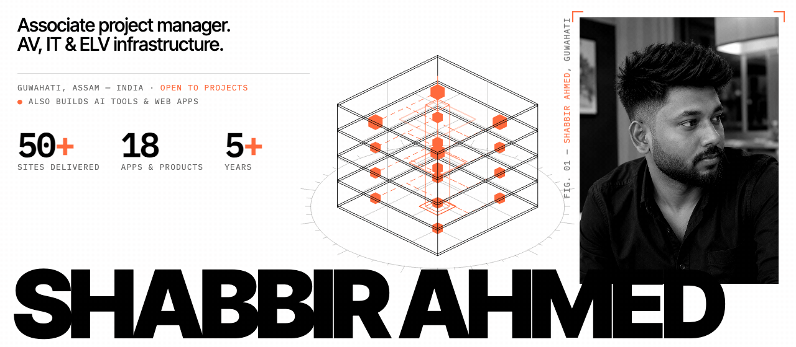
  </picture>
</a>

  
  
  
  

 

<picture><source media="(prefers-color-scheme: dark)" srcset="assets/ui/products-dark.png" />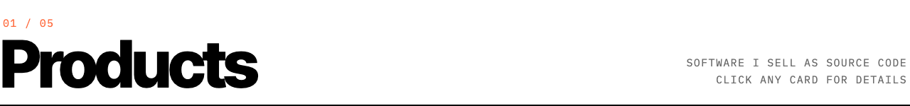</picture>

<a href="https://github.com/shabbir2024a-dot/titan-ai-trading-desk">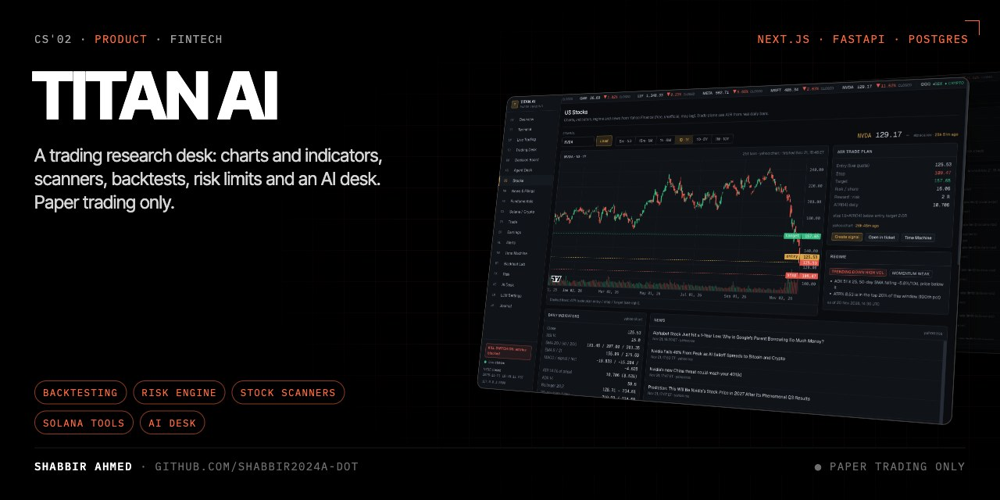</a>

<table>
<tr>
<td width="50%"></td>
<td width="50%"><a href="https://github.com/shabbir2024a-dot/reviewpilot">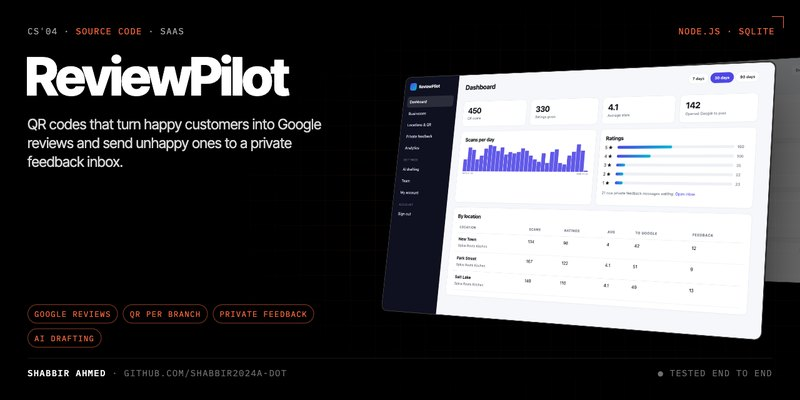</a></td>
</tr>
<tr>
<td width="50%"><a href="https://github.com/shabbir2024a-dot/linkforge">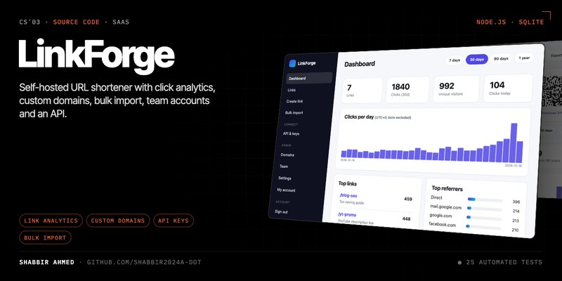</a></td>
<td width="50%"><a href="https://github.com/shabbir2024a-dot/keyforge">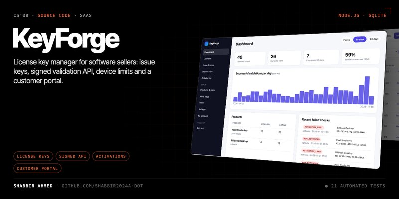</a></td>
</tr>
<tr>
<td width="50%"></td>
<td width="50%"></td>
</tr>
<tr>
<td width="50%"><a href="https://github.com/shabbir2024a-dot/vcard-pro">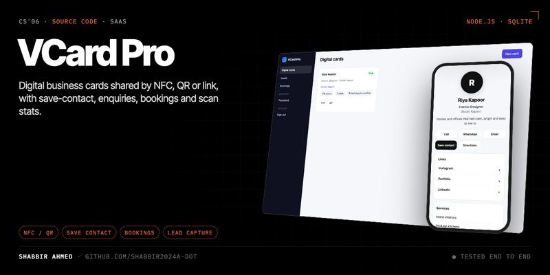</a></td>
<td width="50%"></td>
</tr>
<tr>
<td width="50%"><a href="https://github.com/shabbir2024a-dot/shabbir2024a-dot/tree/main/showcase/small-business-tools">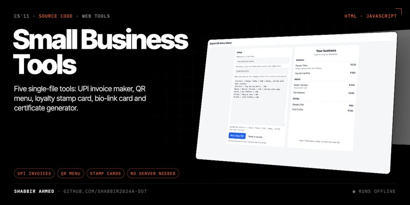</a></td>
<td width="50%">
 <b>Want one of these?</b> Full source code, setup guide and licence.  
</td>
</tr>
</table>

 

<picture><source media="(prefers-color-scheme: dark)" srcset="assets/ui/client-dark.png" />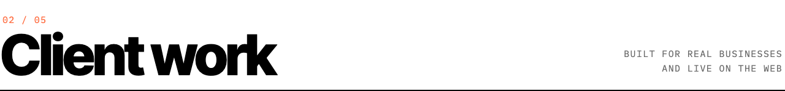</picture>

<a href="https://github.com/shabbir2024a-dot/kiga-qr-ordering-loyalty">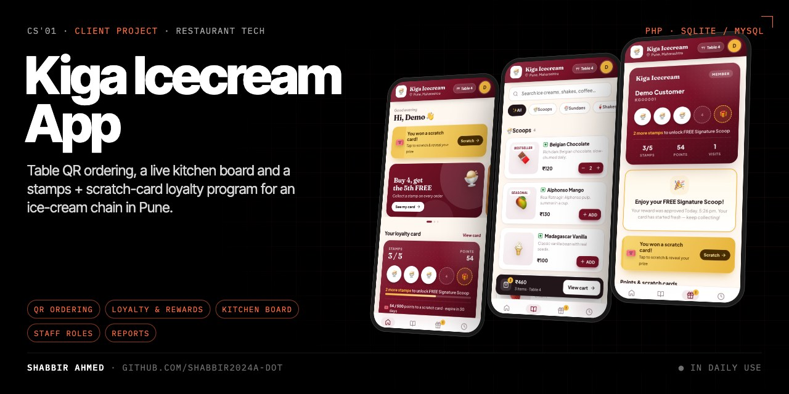</a>

<table>
<tr>
<td width="50%"></td>
<td width="50%"></td>
</tr>
<tr>
<td width="50%"><a href="https://github.com/shabbir2024a-dot/homestay-demo">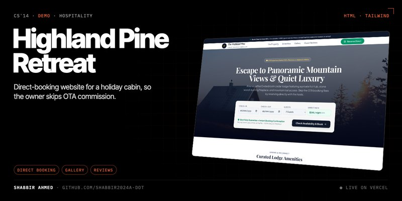</a></td>
<td width="50%"><a href="https://github.com/shabbir2024a-dot/ai-toolkit-pro">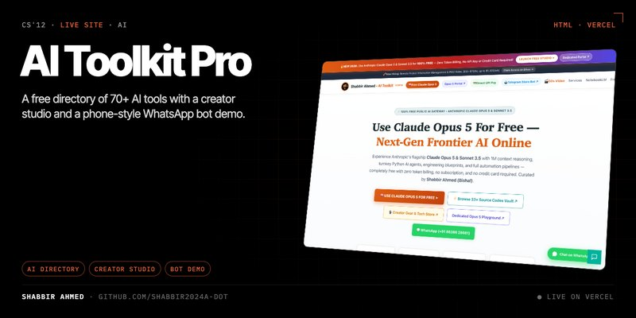</a></td>
</tr>
</table>

<a href="https://github.com/shabbir2024a-dot/shorts-output">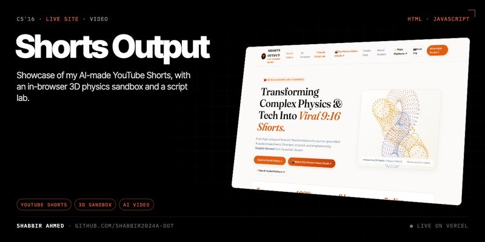</a>

 

<picture><source media="(prefers-color-scheme: dark)" srcset="assets/ui/open-dark.png" />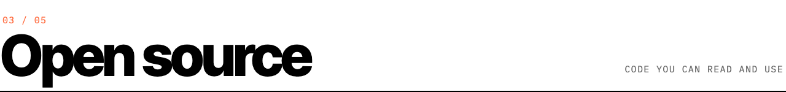</picture>

<table>
<tr>
<td width="50%"><a href="https://github.com/shabbir2024a-dot/autonomous-browser-agent-hub">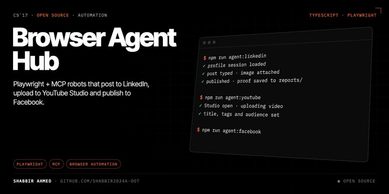</a></td>
<td width="50%"><a href="https://github.com/shabbir2024a-dot/antopus-crm-leads-engine">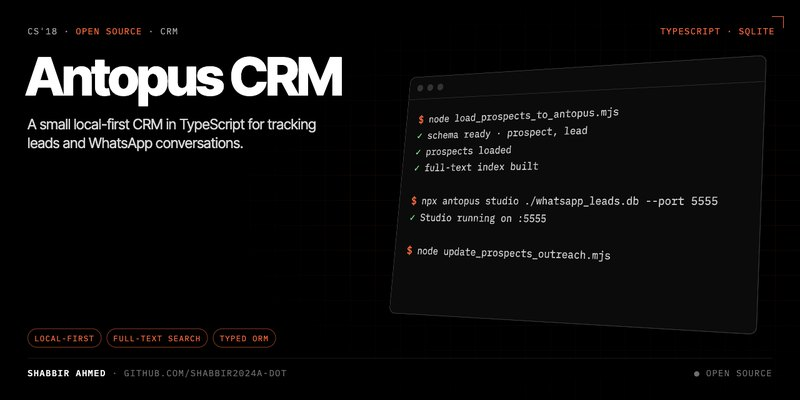</a></td>
</tr>
</table>

 

<picture><source media="(prefers-color-scheme: dark)" srcset="assets/ui/about-dark.png" />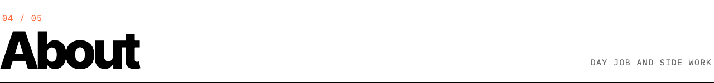</picture>

<picture><source media="(prefers-color-scheme: dark)" srcset="assets/ui/aboutcard-dark.jpg" />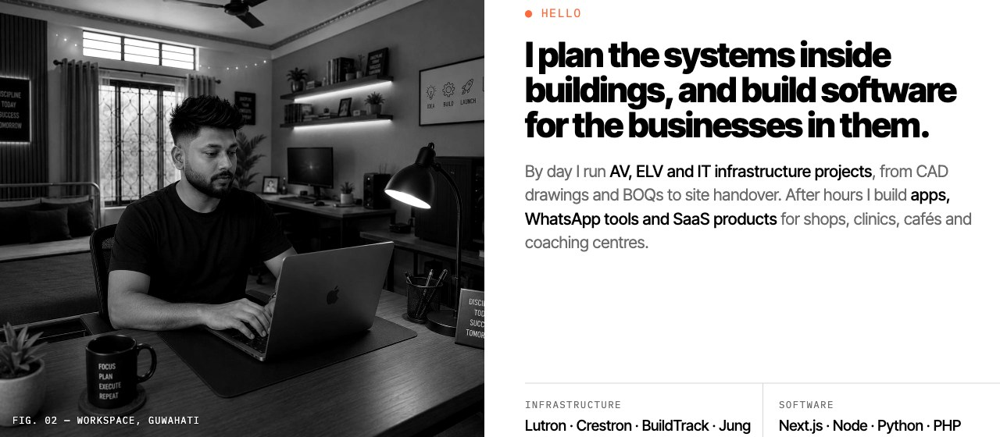</picture>

 

<picture><source media="(prefers-color-scheme: dark)" srcset="assets/ui/stack-dark.png" />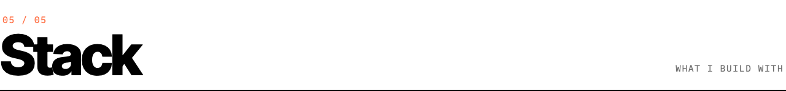</picture>

 

<picture>
  <source media="(prefers-color-scheme: dark)" srcset="https://skillicons.dev/icons?i=ts,js,python,php,react,nextjs,threejs,tailwind,nodejs,fastapi,postgres,sqlite,vercel,gcp,docker,linux&perline=16&theme=dark" />
  
</picture>

AV, lighting &amp; automation: Lutron · Crestron · BuildTrack · Jung · Endo · Control4 · Delta Light · networking &amp; ELV &nbsp;·&nbsp; AI: Claude · Gemini · GPT · Playwright · MCP

  

<a href="mailto:shabbir2024a@gmail.com"><picture><source media="(prefers-color-scheme: dark)" srcset="assets/ui/footer-dark.png" />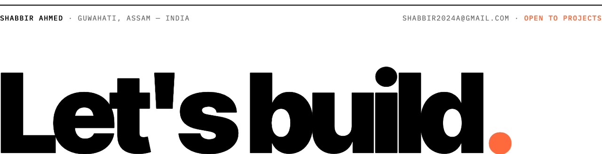</picture></a>

  <a href="mailto:shabbir2024a@gmail.com">Email</a> · <a href="https://www.linkedin.com/in/shabbir-ahmed-a095a3334/">LinkedIn</a> · <a href="https://shabbir-ahmed-portfolio-3d.vercel.app">Portfolio</a>

