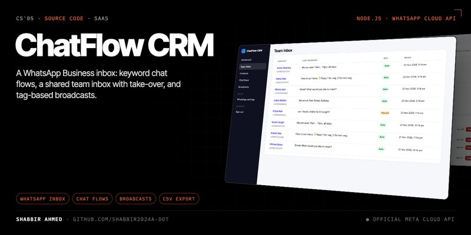
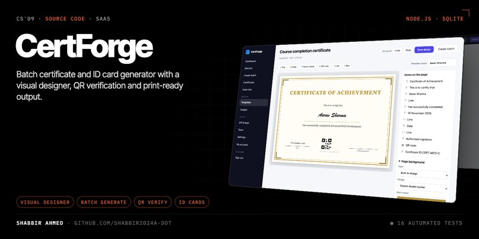
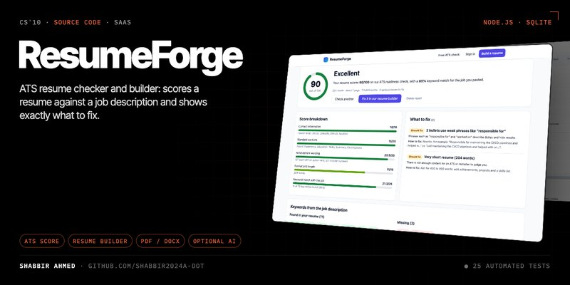
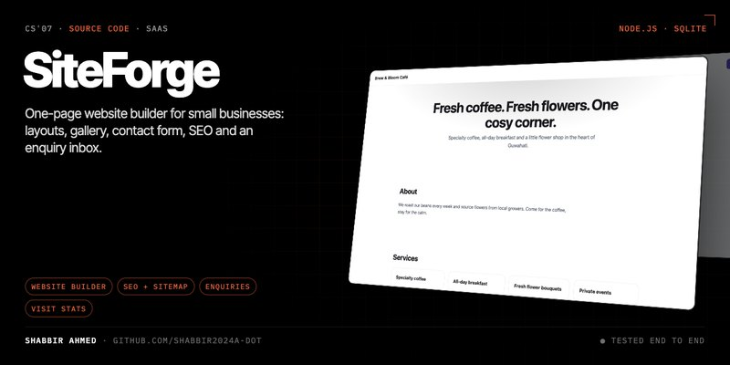
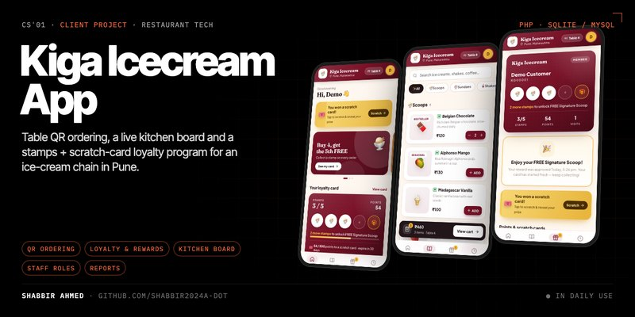
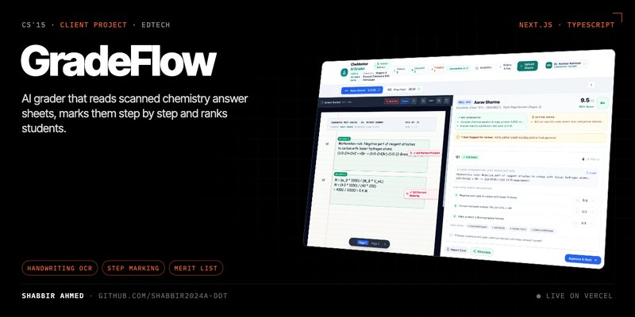
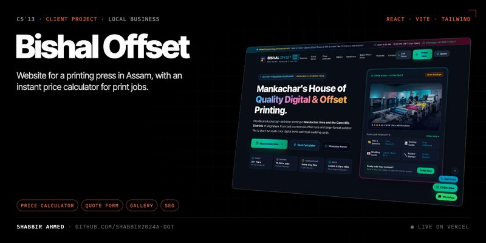

<a href="https://shabbir-ahmed-portfolio-3d.vercel.app">
  <picture>
    <source media="(prefers-color-scheme: dark)" srcset="assets/header-dark.gif" />
    
  </picture>
</a>

  
  
  
  

I manage **AV, ELV and IT infrastructure projects** (50+ commercial and residential spaces, from drawings to handover). On the side I **build software for small businesses**: ordering apps, WhatsApp tools, SaaS products and websites.

---

### 01 — Products

Ready-made software I sell as source code. Each page has screenshots and features.

<table>
<tr>
<td width="50%"></td>
<td width="50%"></td>
</tr>
<tr>
<td></td>
<td></td>
</tr>
<tr>
<td></td>
<td></td>
</tr>
<tr>
<td></td>
<td></td>
</tr>
<tr>
<td></td>
<td></td>
</tr>
</table>

### 02 — Client work & live sites

<table>
<tr>
<td width="50%"></td>
<td width="50%"></td>
</tr>
<tr>
<td></td>
<td></td>
</tr>
<tr>
<td></td>
<td></td>
</tr>
</table>

### 03 — Open source

<table>
<tr>
<td width="50%"></td>
<td width="50%"></td>
</tr>
</table>

---

### 04 — What I do

<table>
<tr>
<td width="50%" valign="top">

**Infrastructure projects** — day job

- AV, ELV and structured IT networks
- Smart building and automation systems
- CAD schematics, BOQ / BOM costing, vendors
- Site audits, testing and commissioning

Crestron · Extron · Biamp · Q-SYS · Dante · Cisco · UniFi

</td>
<td width="50%" valign="top">

**Software for small businesses** — side work

- QR ordering, loyalty and booking apps
- WhatsApp inboxes and assistants
- Self-hosted SaaS tools, sold as source code
- Browser automation with Playwright + MCP

Claude · Gemini · GPT · Playwright · MCP

</td>
</tr>
</table>

### 05 — Stack

<picture>
  <source media="(prefers-color-scheme: dark)" srcset="https://skillicons.dev/icons?i=ts,js,python,php,react,nextjs,threejs,tailwind,nodejs,fastapi,postgres,sqlite,vercel,gcp,docker,linux&perline=16&theme=dark" />
  
</picture>

---

  <b>Need an app, a WhatsApp tool or help with an AV / IT project?</b> 
  <a href="mailto:shabbir2024a@gmail.com">Email me</a> · <a href="https://www.linkedin.com/in/shabbir-ahmed-a095a3334/">LinkedIn</a> · <a href="https://shabbir-ahmed-portfolio-3d.vercel.app">Portfolio</a>

