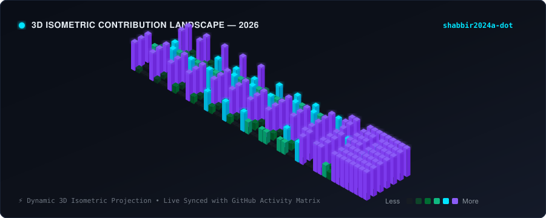

<div align="center">

  <!-- TYPING SVG HEADER (Optimized width & size so text never truncates) -->
  <a href="https://ai-toolkit-pro-eta.vercel.app/">
    
  </a>

  <p align="center">
    <b>AI Systems Architecture • Autonomous Browser Robots • WhatsApp Cloud AI • Production Microservices</b><br/>
    <i>Architecting self-driving digital workflows, autonomous agent fleets & resilient cloud intelligence ⚡</i>
  </p>

  <!-- BADGES ROW -->
  <p align="center">
    
    
    
    <a href="https://komarev.com/ghpvc/?username=shabbir2024a-dot&color=00e5ff&style=for-the-badge&label=PROFILE+VIEWS">
      
    </a>
  </p>

  <!-- QUICK SOCIAL & PLATFORM LINKS -->
  <p align="center">
    <a href="https://ai-toolkit-pro-eta.vercel.app/">
      
    </a>
    &nbsp;•&nbsp;
    <a href="https://github.com/shabbir2024a-dot/autonomous-browser-agent-hub">
      
    </a>
    &nbsp;•&nbsp;
    <a href="https://ai-toolkit-pro-eta.vercel.app/bot-dashboard">
      
    </a>
    &nbsp;•&nbsp;
    <a href="https://www.linkedin.com/in/shabbir-ahmed-a095a3334/">
      
    </a>
    &nbsp;•&nbsp;
    <a href="mailto:shabbir2024a@gmail.com">
      
    </a>
    &nbsp;•&nbsp;
    <a href="https://github.com/shabbir2024a-dot?tab=followers">
      
    </a>
  </p>

</div>

---

### ⚡ Executive Overview

I am an **AI Systems Architect, Builder, and Founder** based in Guwahati, India. I specialize in designing and deploying full-stack autonomous systems that bridge cutting-edge foundational reasoning models (Claude Opus/Sonnet, InceptionLabs Mercury-3, GPT-4o), high-availability cloud infrastructure (Google Cloud Compute Engine, Vercel Edge Serverless), and self-driving browser automation (Playwright MCP bots across LinkedIn, YouTube, and Facebook).

- 🔭 **Flagship Platform**: [**AI Toolkit Pro**](https://ai-toolkit-pro-eta.vercel.app/) — Enterprise creator toolkit featuring a zero-cost Claude Opus 5 studio, 70+ curated AI tools, and an interactive smartphone WhatsApp AI bot simulator.
- 🤖 **Autonomous Browser Hub**: [**Autonomous Browser Agent Hub**](https://github.com/shabbir2024a-dot/autonomous-browser-agent-hub) — Self-driving multi-platform browser automation across LinkedIn, YouTube Studio, and Facebook powered by Playwright Stealth and Model Context Protocol (MCP).
- 💬 **Autonomous AI Receptionist**: [**24/7 WhatsApp AI Bot**](https://github.com/shabbir2024a-dot/whatsapp-ai-bot) — Deployed on Google Cloud Always-Free VPS (`35.238.38.242`) with sub-2s response latency, Baileys multi-device sockets, dynamic green "typing..." presence emulation, and an anti-ban outbound lead engine.
- 🗄️ **Lead Intelligence & CRM**: [**Antopus CRM Leads Engine**](https://github.com/shabbir2024a-dot/antopus-crm-leads-engine) — Zero-dependency embedded TypeScript database built on `@bigsur/antopus`, managing 200+ verified Guwahati B2B prospects with full-text search and web Studio interface.
- 🎯 **Engineering Principles**: Sub-second latency, zero-lock-in local-first databases, self-healing daemons, and measurable business revenue.

---

### 🎮 Interactive 3D Spatial & Activity Experience

<div align="center">

  <p align="center">
    <a href="https://bishal-portfolio-three.vercel.app/" target="_blank">
      
    </a>
    &nbsp;&nbsp;
    <a href="https://github.com/shabbir2024a-dot/bishal-portfolio-3d" target="_blank">
      
    </a>
  </p>

  <p align="center">
    <b>Isometric 3D Contribution Landscape (Voxel Activity Grid)</b><br/>
    <i>Continuous year-round engineering activity rendered in 3D isometric perspective.</i>
  </p>

  <a href="https://github.com/shabbir2024a-dot">
    
  </a>

</div>

---

### 🌐 Live Infrastructure Status (Always-On 24/7)

```
┌────────────────────────────────────────────────────────────────────────────────────────┐
│  📡 CLOUD CLUSTERS & ACTIVE DEPLOYMENTS                                                │
├────────────────────────────────────────────────────────────────────────────────────────┤
│  ⚡ Google Cloud VPS (us-central1-f) │ IP: 35.238.38.242 │ PM2 Daemon │ 2GB Linux Swap   │
│  🤖 Conversational Engine            │ InceptionLabs Mercury-3 LLM │ Sub-2s Latency     │
│  📱 WhatsApp Multi-Device Gateway    │ Baileys Socket │ Auto Reconnect │ Zero-Ban Guard │
│  🚀 Global Edge Network              │ Vercel Serverless │ 10-Min Cloud Keepalive Ping │
│  🗄️ Embedded Database Engine        │ @bigsur/antopus │ 200+ Leads │ Port 5555 Studio  │
│  🤖 Autonomous Browser Hub           │ Playwright Stealth │ LinkedIn + YouTube + FB     │
└────────────────────────────────────────────────────────────────────────────────────────┘
```

---

### 🚀 Production Vercel Deployments & Live Web Applications

A high-performance cluster of production SaaS, creator suites, video AI generators, and local business automation platforms deployed globally across **Vercel's Edge Network**:

| Platform | Production URL | Primary Focus & Capabilities | Tech Stack | Status | Repository |
|:---|:---|:---|:---|:---:|:---:|
| **AI Toolkit Pro** | [ai-toolkit-pro-eta.vercel.app](https://ai-toolkit-pro-eta.vercel.app/) | Flagship Creator Suite • Claude Opus 5 Studio • 70+ AI Tools • WhatsApp Smartphone Demo & Control Center | `Next.js 14` `TypeScript` `Tailwind` |  | [⭐ Code](https://github.com/shabbir2024a-dot/ai-toolkit-pro) |
| **Autonomous Browser Hub** | [github.com/shabbir2024a-dot/autonomous-browser-agent-hub](https://github.com/shabbir2024a-dot/autonomous-browser-agent-hub) | Autonomous Browser Robots • LinkedIn TipTap Automation • YouTube Studio Video Upload • FB Publisher • MCP Protocol | `Playwright` `TypeScript` `MCP` |  | [⭐ Code](https://github.com/shabbir2024a-dot/autonomous-browser-agent-hub) |
| **Bishal Offset** | [bishal-offset.vercel.app](https://bishal-offset.vercel.app/) | Commercial Printing, Packaging & Offset Press Digital Quoting Engine with Live Estimator | `React` `Next.js` `Tailwind` |  | [⭐ Code](https://github.com/shabbir2024a-dot/bishal-offset) |
| **Homestay Concierge** | [homestay-demo-phi.vercel.app](https://homestay-demo-phi.vercel.app/) | Luxury Hospitality & Homestay Booking Engine with Automated WhatsApp VIP Concierge | `Next.js` `Tailwind` `WhatsApp API` |  | [⭐ Code](https://github.com/shabbir2024a-dot/homestay-demo) |
| **Shorts Output** | [shorts-output.vercel.app](https://shorts-output.vercel.app/) | Automated YouTube Shorts Studio & Motion Graphics Video Generation Pipeline | `HTML5 Canvas` `JavaScript` `CSS3` |  | [⭐ Code](https://github.com/shabbir2024a-dot/shorts-output) |
| **Open Higgsfield Free** | [open-higgsfield-free.vercel.app](https://open-higgsfield-free.vercel.app/) | Generative AI Video Generation Portal with Camera Motion Prompt Controls | `Next.js` `Video AI` `Edge API` |  | [🌐 Live App](https://open-higgsfield-free.vercel.app/) |
| **GradeFlow** | [gradeflow-rouge.vercel.app](https://gradeflow-rouge.vercel.app/) | Intelligent Student Assessment, Grading & Academic Performance Analytics SaaS | `Next.js` `TypeScript` `EdTech` |  | [🌐 Live App](https://gradeflow-rouge.vercel.app/) |
| **Bishal 3D Spatial Portfolio** | [bishal-portfolio-three.vercel.app](https://bishal-portfolio-three.vercel.app/) | Interactive Three.js / WebGL 3D Spatial Environment with Real-Time Lighting & Camera Controls | `Three.js` `WebGL` `React` |  | [⭐ Code](https://github.com/shabbir2024a-dot/bishal-portfolio-3d) |
| **Shabbir Portfolio V2** | [shabbir-portfolio-v2.vercel.app](https://shabbir-portfolio-v2.vercel.app/) | Enterprise Systems Architecture, AV/IT Infrastructure & Generative AI Systems | `Next.js` `Framer Motion` `Tailwind` |  | [⭐ Code](https://github.com/shabbir2024a-dot/portfolio) |
| **AI Sales Machine** | [ai-sales-machine.vercel.app](https://ai-sales-machine.vercel.app/) | Autonomous B2B Funnel, Lead Qualification & WhatsApp Outreach Pipeline | `Next.js` `Sales AI` `Vercel Edge` |  | [🌐 Live App](https://ai-sales-machine.vercel.app/) |
| **Shabbir Portfolio Site** | [shabbir-portfolio-site.vercel.app](https://shabbir-portfolio-site.vercel.app/) | Interactive Founder Showcase, Client Acquisition & Technology Advisory | `React` `Tailwind` `Modern UI` |  | [🌐 Live App](https://shabbir-portfolio-site.vercel.app/) |

---

### 🏆 Featured & Flagship Repositories

<table>
  <tr>
    <td width="50%" valign="top">
      <h3>🚀 <a href="https://github.com/shabbir2024a-dot/ai-toolkit-pro">AI Toolkit Pro</a></h3>
      <p><b>Flagship AI Creator Suite & Cloud Architecture</b></p>
      <ul>
        <li>✨ <b>Free Claude Opus 5 Studio</b>: Turnkey engineering specs & code generation without token gating.</li>
        <li>🧰 <b>70+ Curated AI Tools</b>: Categorized directory with instant prompt copy & live previews.</li>
        <li>📱 <b>Live Smartphone Bot Demo</b>: Interactive in-browser phone simulator for client pitches.</li>
        <li>⚡ <b>Vercel Edge Network</b>: Globally distributed serverless endpoints & microservices.</li>
      </ul>
      <p>
        <a href="https://ai-toolkit-pro-eta.vercel.app/"><b>🌐 Visit Live App →</b></a> &nbsp;|&nbsp;
        <a href="https://github.com/shabbir2024a-dot/ai-toolkit-pro"><b>⭐ View Source</b></a>
      </p>
    </td>
    <td width="50%" valign="top">
      <h3>💬 <a href="https://github.com/shabbir2024a-dot/whatsapp-ai-bot">24/7 WhatsApp AI Agent</a></h3>
      <p><b>Autonomous Cloud Conversational Receptionist</b></p>
      <ul>
        <li>🤖 <b>Mercury-3 LLM Brain</b>: Sub-2s contextual multi-turn conversation memory with warm onboarding.</li>
        <li>🟢 <b>Human Presence Emulation</b>: Blue tick read receipts + realistic text-length typing delays.</li>
        <li>☁️ <b>Google Cloud VPS</b>: Persistent Debian host with PM2 process manager and 2GB swap.</li>
        <li>🛡️ <b>Anti-Ban Safe Outreach</b>: Stealth inquiry engine with 60–75s pacing across verified B2B leads.</li>
      </ul>
      <p>
        <a href="https://ai-toolkit-pro-eta.vercel.app/bot-dashboard"><b>📊 Live Dashboard →</b></a> &nbsp;|&nbsp;
        <a href="https://github.com/shabbir2024a-dot/whatsapp-ai-bot"><b>⭐ View Source</b></a>
      </p>
    </td>
  </tr>
  <tr>
    <td width="50%" valign="top">
      <h3>🗄️ <a href="https://github.com/shabbir2024a-dot/antopus-crm-leads-engine">Antopus CRM & Leads Engine</a></h3>
      <p><b>Zero-Dependency TypeScript Database & Outreach Intelligence</b></p>
      <ul>
        <li>💾 <b>Zero External DBs</b>: Pure TypeScript embedded database (SQL + documents + typed ORM).</li>
        <li>🏢 <b>200 Verified Guwahati Prospects</b>: Curated B2B leads across 5 high-converting industries.</li>
        <li>🔍 <b>Full-Text Search Indexing</b>: Sub-millisecond FTS query engine over message transcripts.</li>
        <li>🖥️ <b>Studio UI Console</b>: Interactive visual table management live on Port 5555.</li>
      </ul>
      <p>
        <a href="https://github.com/shabbir2024a-dot/antopus-crm-leads-engine"><b>⭐ View Repository →</b></a>
      </p>
    </td>
    <td width="50%" valign="top">
      <h3>🤖 <a href="https://github.com/shabbir2024a-dot/autonomous-browser-agent-hub">Autonomous Browser Agent Hub</a></h3>
      <p><b>Playwright Stealth & Model Context Protocol (MCP) Multi-Platform Robot</b></p>
      <ul>
        <li>💼 <b>LinkedIn Feed Automation</b>: TipTap rich-text typing emulation, media attachments & proof capture.</li>
        <li>🎥 <b>YouTube Studio Manager</b>: Autonomous video binary uploads, metadata injection & analytics.</li>
        <li>📱 <b>Facebook Publisher</b>: Page & feed updates with persistent profile session vaults.</li>
        <li>🔌 <b>MCP Open Protocol</b>: Standardized JSON-RPC tools for autonomous agent orchestration.</li>
      </ul>
      <p>
        <a href="https://github.com/shabbir2024a-dot/autonomous-browser-agent-hub"><b>⭐ View Repository →</b></a>
      </p>
    </td>
  </tr>
</table>

---

### 🛠️ Technology Radar & Arsenal

<div align="center">

| Domain | Stack & Tools |
|:---|:---|
| **AI & LLM Orchestration** | `InceptionLabs Mercury-3` `Claude 3.5 Sonnet` `Claude Opus 5` `OpenAI GPT-4o` `Gemini 2.0 Flash` `Vercel AI SDK` `Prompt Engineering` |
| **Autonomous Browser & Agent Ops** | `Playwright Core` `Model Context Protocol (MCP)` `Headless Chromium` `Stealth Scrapers` `DOM Virtualization` `Anti-Ban Sockets` |
| **Languages & Core** | `TypeScript` `JavaScript (ES6+)` `Node.js LTS (v22)` `Python 3` `SQL` `HTML5` `CSS3` `Bash / Zsh` |
| **Cloud & Infrastructure** | `Google Cloud Platform (GCP VPS)` `Vercel Serverless Edge` `Render` `Docker` `Linux Debian` `PM2` `systemd` `iptables` |
| **Databases & Local-First** | `@bigsur/antopus TS DB` `SQLite WAL` `Baileys WebSockets` `PostgreSQL` `Redis` `TSV Vaults` |
| **Frontend & UI Engineering** | `Next.js 14` `React 19` `Tailwind CSS` `Three.js / WebGL` `Shadcn UI` `Radix UI` `Lucide Icons` `Chart.js` |

</div>

---

### 📊 GitHub Activity & Metrics

<div align="center">

  
  &nbsp;
  

  <br/><br/>

  

</div>

---

### 🤝 Let's Collaborate & Connect

<div align="center">

  <a href="https://www.linkedin.com/in/shabbir-ahmed-a095a3334/">
    
  </a>
  &nbsp;
  <a href="mailto:shabbir2024a@gmail.com">
    
  </a>
  &nbsp;
  <a href="https://ai-toolkit-pro-eta.vercel.app/whatsapp-demo">
    
  </a>
  &nbsp;
  <a href="https://ai-toolkit-pro-eta.vercel.app/">
    
  </a>
  &nbsp;
  <a href="https://github.com/shabbir2024a-dot">
    
  </a>

  <br/><br/>
  <sub><i>⚡ "The best way to predict the future is to automate it." — Engineered with passion in Guwahati, Assam, India.</i></sub>

</div>
