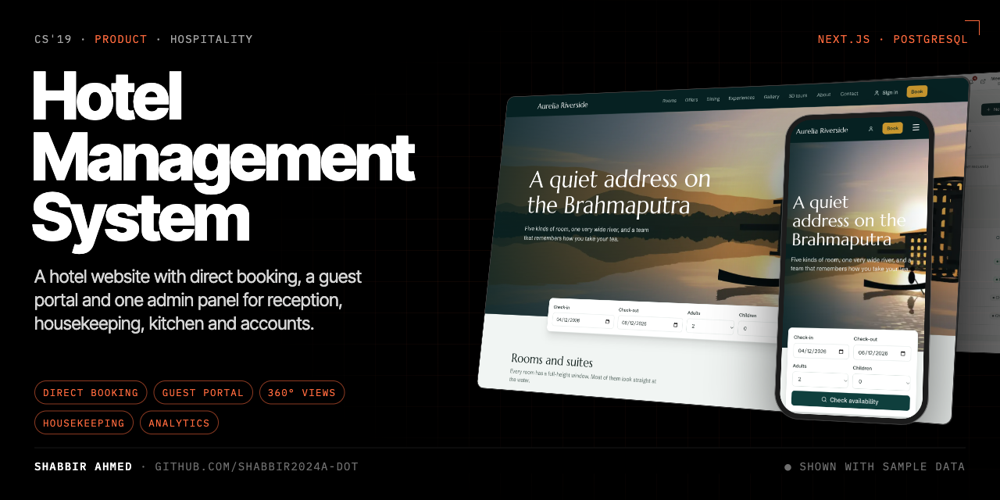

# Hotel Management System

One system for a whole hotel: a public website that takes direct bookings, a guest portal for people staying, and an admin panel for reception, housekeeping, the kitchen and accounts.

> The screens below use a made-up hotel and sample data. In the demonstration, online payments are simulated and e-mails are recorded rather than sent.

## Website and booking

- Room pages with photos, amenities and live prices
- Search by dates and guests, then book direct
- 360° room views you can drag and zoom
- Offers, gallery, enquiries and a restaurant menu with ordering

**Public website**

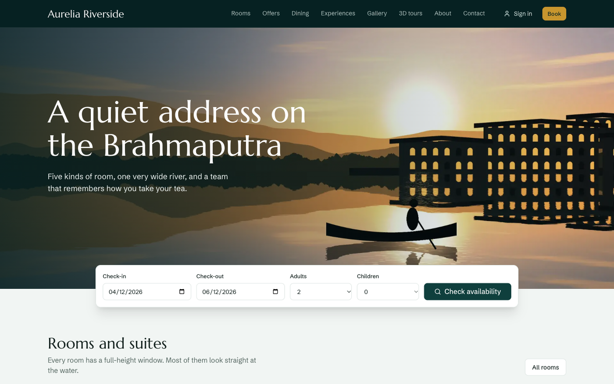

**Room page**

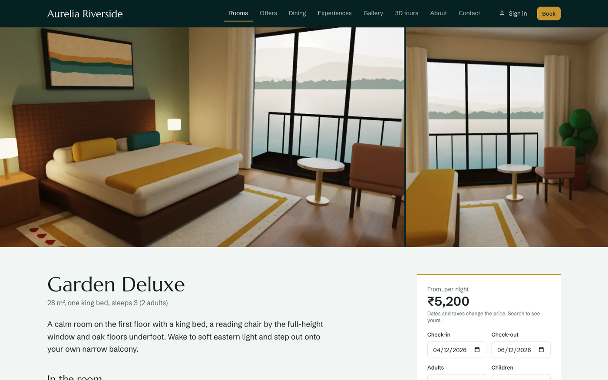

**360° view**

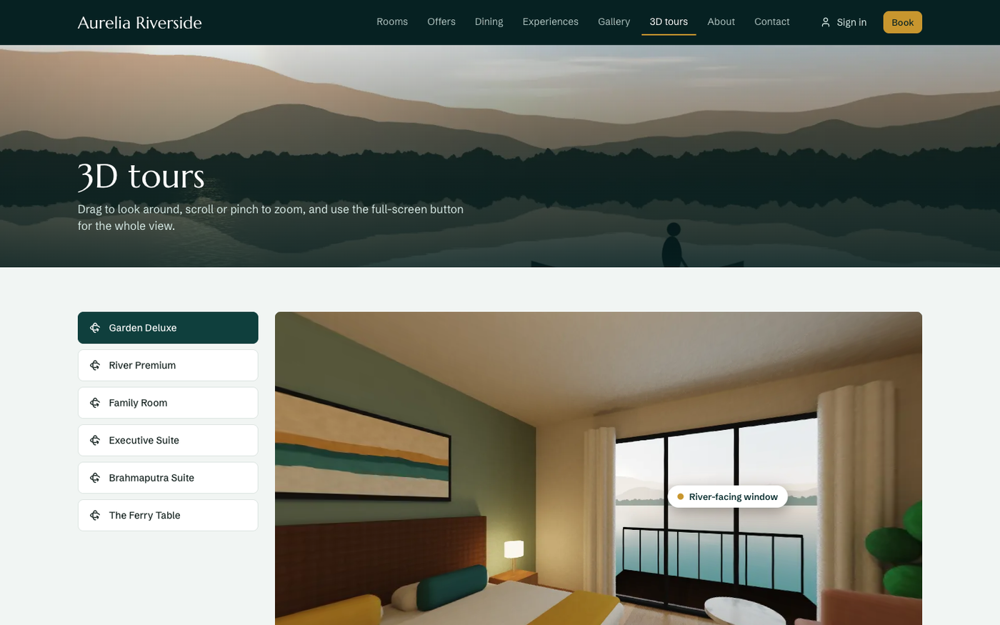

## Guest portal

- The current stay, room number and bill
- Room service orders and requests to the front desk

**Guest portal**

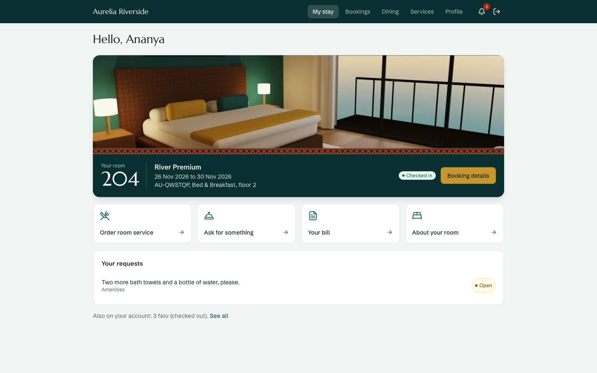

## Admin panel

- Dashboard of arrivals, departures, revenue and what needs attention
- Reservation calendar with drag to move a booking
- Rates for seasons, weekends and demand, plus coupons and taxes
- Housekeeping and maintenance boards
- Restaurant orders and menu
- Guest records with stay history, spend, VIP tag and notes
- Payments, invoices, revenue reports and analytics
- Staff roles that limit what each person can see and do

**Dashboard**

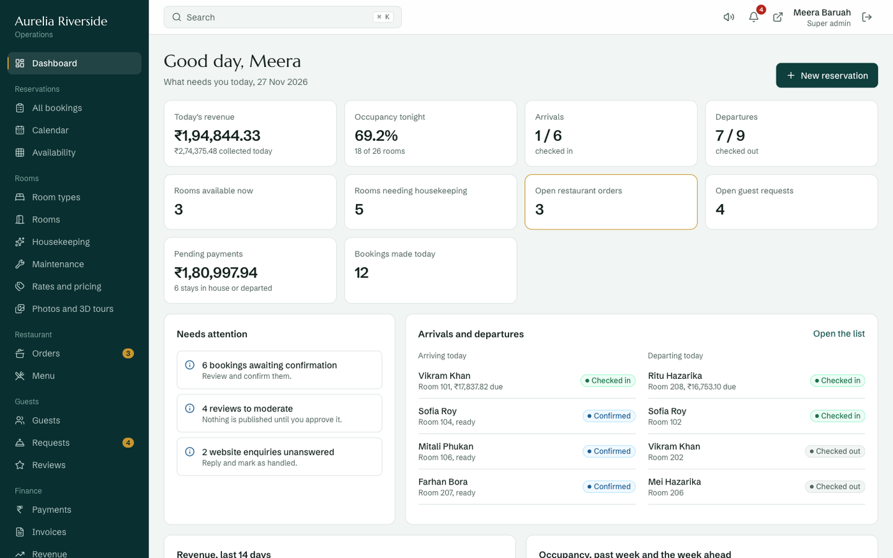

**Reservation calendar**

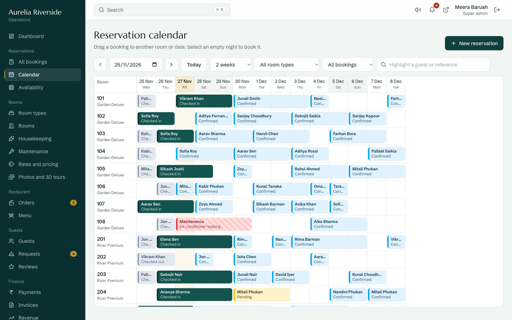

**Housekeeping**

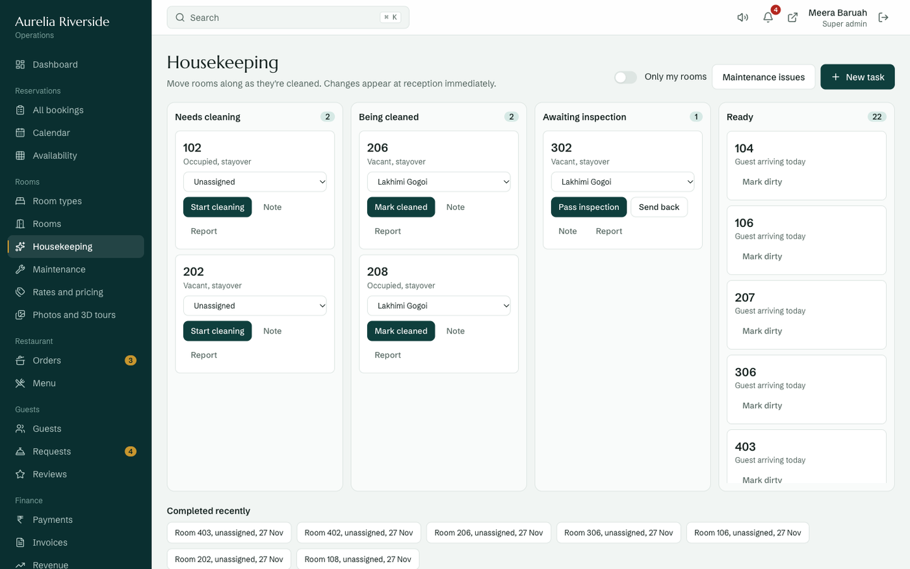

**Restaurant orders**

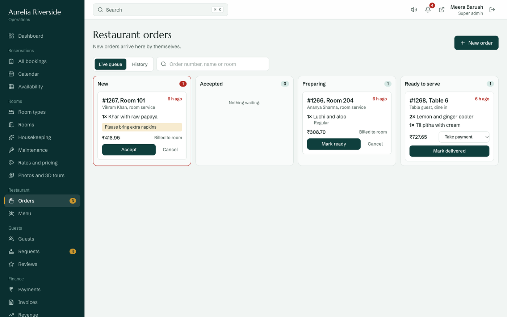

**Rates and pricing**

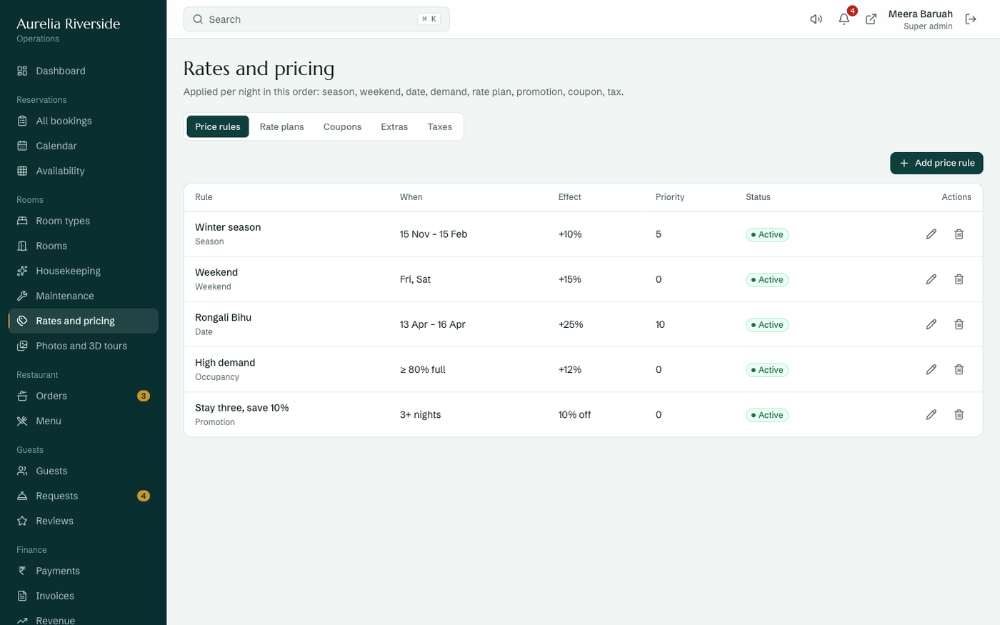

**Analytics**

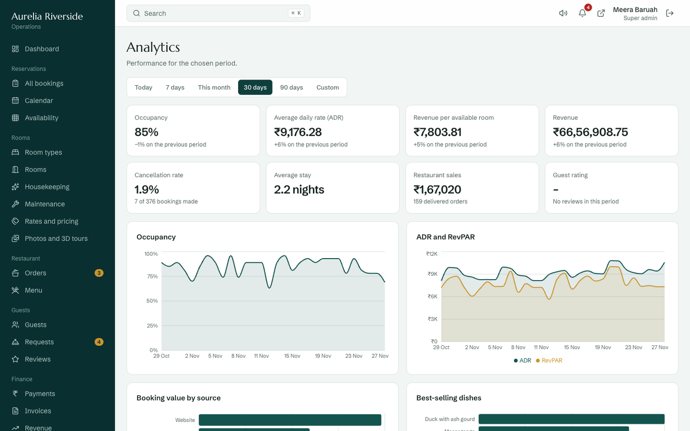

## On a phone

  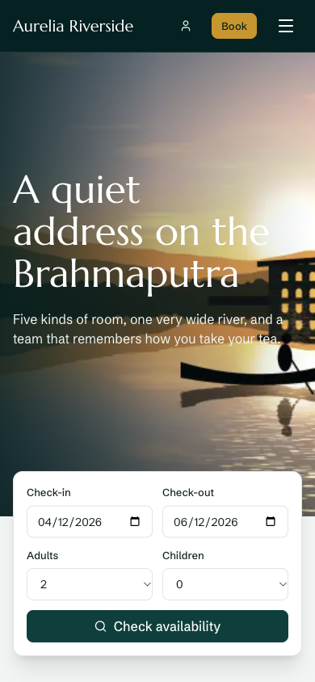
  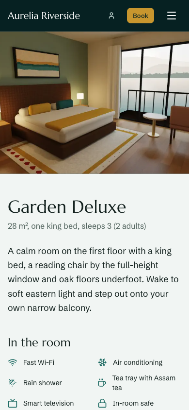
  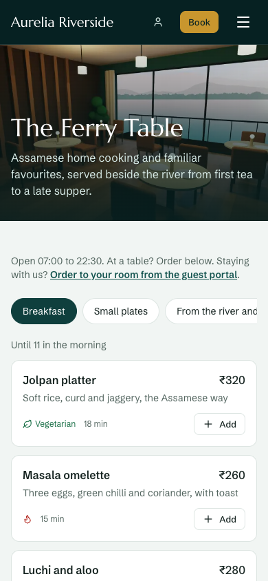

## Built with

Next.js · React · TypeScript · PostgreSQL · Prisma · Tailwind CSS · automated tests with Vitest and Playwright

## Want this for your hotel?

The source code is **not published here**. I set the system up with your hotel's rooms, prices, photos and wording.

---

Made by [Shabbir Ahmed](https://github.com/shabbir2024a-dot) · Guwahati, India
