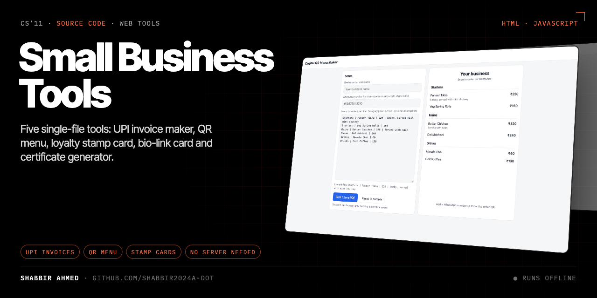
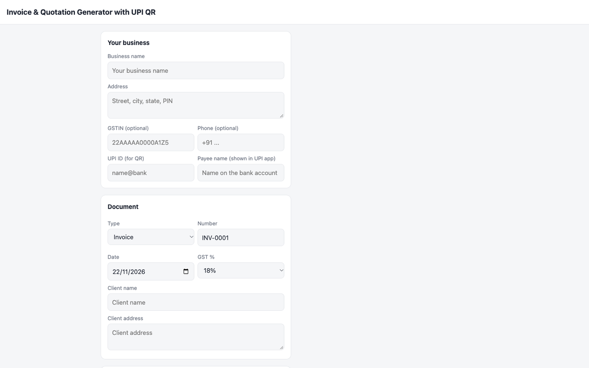
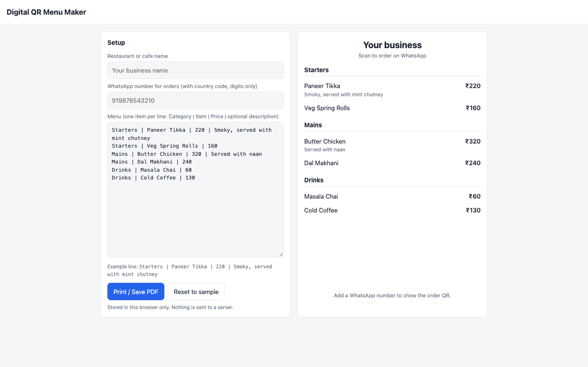
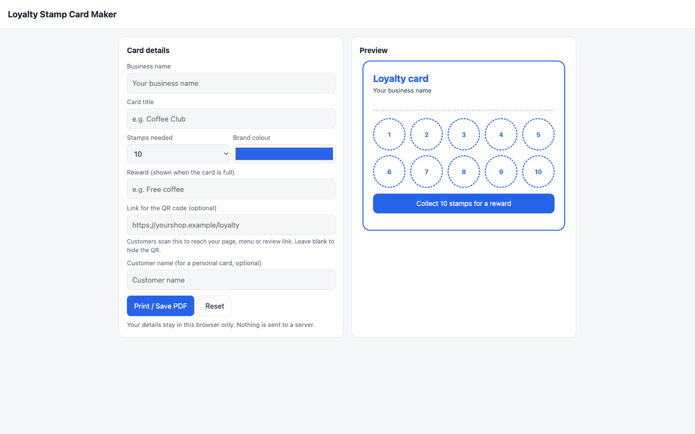

# Small Business Tools

Five small tools, each a single HTML file. No server, no sign-up: open the file in a browser, fill it in, and print or save as PDF. Data stays in the browser.

## The tools

- **Invoice & quotation generator** with GST and a UPI QR code
- **Digital QR menu maker** with a WhatsApp order QR code
- **Loyalty stamp card maker** (5 to 20 stamps)
- **Bio-link & business card maker** with a contact QR code
- **Batch certificate generator**, numbered from 001

## Screenshots

**Invoice with UPI QR**

**QR menu**

**Stamp card**

## Built with

HTML · CSS · JavaScript, one file per tool · works offline

## Get the source code

The source code is **not in this repository**. It is sold as a one-time purchase that includes the full code, a setup guide and a licence to run it for your business or clients.

---

Made by [Shabbir Ahmed](https://github.com/shabbir2024a-dot) · Guwahati, India
